# Factcalc - User Documentation

**Factcalc (Factory Calculator)** is a desktop application for modeling items, machines, and recipes, and calculating factory production lines (e.g., for Factorio or Satisfactory).

---

## 1. Quick Start

1. Launch Factcalc. The app starts with an empty `Untitled Catalog`.
2. Open **View -> Load Default Catalog** to load the built-in *Sample Factory Preset*, or open your own catalog via **File -> Open Catalog...** (`Ctrl+O`).
3. In the **Production Line Planner** tab, add one or more **Target Outputs** (and optional **Supplied Inputs**), then click **Calculate**.

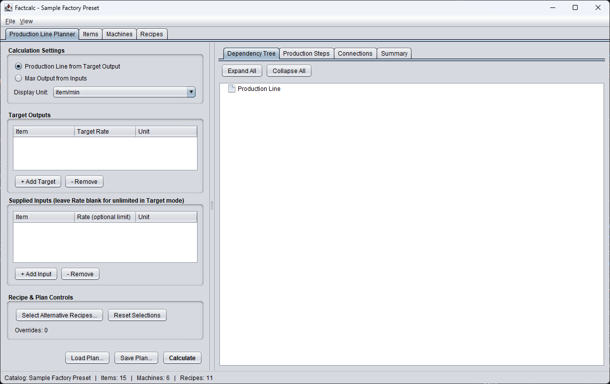

---

## 2. Menu Bar & Status Bar

### `File` Menu

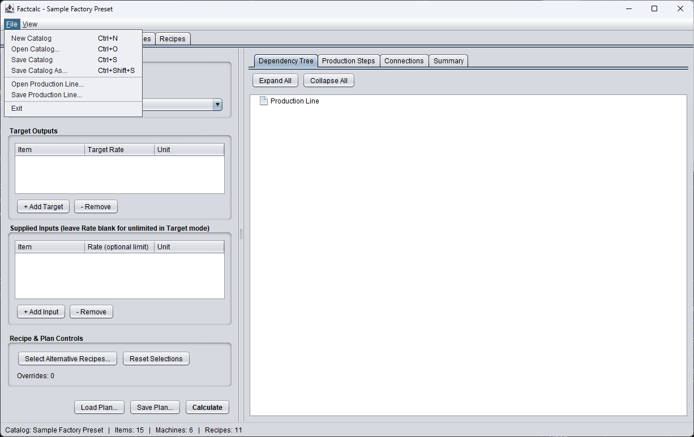

| Menu Item | Shortcut | Description |
| --- | --- | --- |
| **New Catalog** | `Ctrl+N` | Creates a new empty catalog with a custom name. |
| **Open Catalog...** | `Ctrl+O` | Loads a catalog JSON file (items, machines, and recipes). |
| **Save Catalog** | `Ctrl+S` | Saves the active catalog to its current file (prompts for a path if unsaved). |
| **Save Catalog As...** | `Ctrl+Shift+S` | Saves the active catalog to a new JSON file. |
| **Open Production Line...** | - | Loads a saved production plan (`.factplan.json` / `.json`). If IDs differ from the active catalog, warns you and lets you inspect the saved snapshot read-only. |
| **Save Production Line...** | - | Saves the last calculated configuration and result snapshot as a `.factplan.json` file. |
| **Exit** | - | Closes the application (prompts if there are unsaved catalog changes). |

### `View` Menu

- **Load Default Catalog**: Loads the bundled *Sample Factory Preset* (15 items, 6 machines, 11 recipes).

### Status Bar

Displayed at the bottom of the window: shows the active catalog name, `(Modified)` when unsaved changes exist (`*` also appears in the window title), and live counts for **Items**, **Machines**, and **Recipes**.

---

## 3. Production Line Planner Tab

The planner is split into **Configuration** (left) and **Results** (right). Any changes made in the **Items**, **Machines**, or **Recipes** tabs automatically refresh the planner dropdowns and recalculate the active plan.

### 3.1 Configuration Panel (Left)

#### Calculation Settings
- **Production Line from Target Output**: Calculates all machines, upstream steps, and required inputs needed to produce one or more target outputs at specified rates.
- **Max Output from Inputs**: Calculates the maximum achievable output rate of a **single** target item from the supplied input rates, and automatically computes any additional missing raw inputs.
- **Display Unit**: Converts all displayed rates live between `item/sec`, `item/min`, and `item/hr`.

#### Target Outputs
- **Target Output mode**: Add rows with **+ Add Target** and remove with **- Remove**. Click an **Item** cell (`▾`) to pick a target item, edit **Target Rate**, and choose its **Unit**.
- **Max Output mode**: Pick one **Target Item** from the dropdown.
  - **Auto (optimize across alternative recipes)**: Available only in Max Output mode. Searches across original and alternative recipes (and valid byproduct recycling) in the background to maximize output rate. Click **Cancel** to abort a running search.
- *Note:* Only items with at least one producing recipe that has inputs can be selected as targets. Raw items and items produced solely by inputless recipes (e.g., *Pump Water*) are excluded from target selectors.

#### Supplied Inputs
- Add rows with **+ Add Input** and remove with **- Remove**. Any catalog item or machine can be chosen as an input.
- In **Target Output** mode, leave **Rate** blank for unlimited supply, or enter a positive cap to see a warning if demand exceeds your limit.
- In **Max Output** mode, every supplied input must have a positive rate, and at least one supplied input must be used by the production line.

#### Recipe & Plan Controls
- **Select Alternative Recipes...**: Opens a dialog listing items with multiple or alternative recipes so you can explicitly override automatic selection (`-- Automatic (Default Original) --`, `[Original]`, or `[Alternative]`).
- **Reset Selections**: Resets all recipe overrides, per-step machine selections, and byproduct recycling toggles back to defaults.
- **Overrides: N**: Displays the number of active manual recipe overrides.
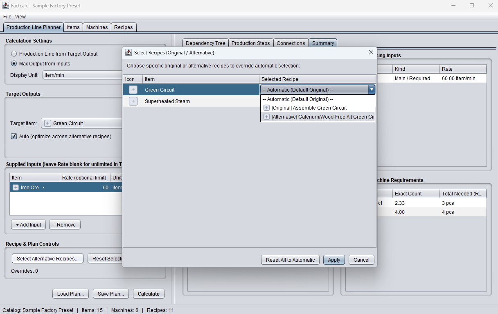

#### Action Buttons
- **Load Plan...** / **Save Plan...**: Shortcuts to load or save a production plan file.
- **Calculate**: Solves the production line.
  - If an item has **multiple original recipes**, a prompt lets you pick which original recipe to use.
  - If an item has **only alternative recipes** in default mode, a prompt lets you choose an alternative recipe or abort planning.

### 3.2 Results Panel (Right)

- **Notices Banner** (appears above the tabs when relevant): Shows informational notes (such as self-sustaining byproduct loops) and warnings (such as input capacity deficits).
- **Dependency Tree**: Hierarchical, cycle-safe tree from final target outputs down to external, raw, and calculated missing inputs. Use **Expand All** / **Collapse All** to navigate. Tags highlight `[Alternative]`, `[External Input]`, `[Calculated Missing Input]`, and `[Recursive Feedback ...]`.
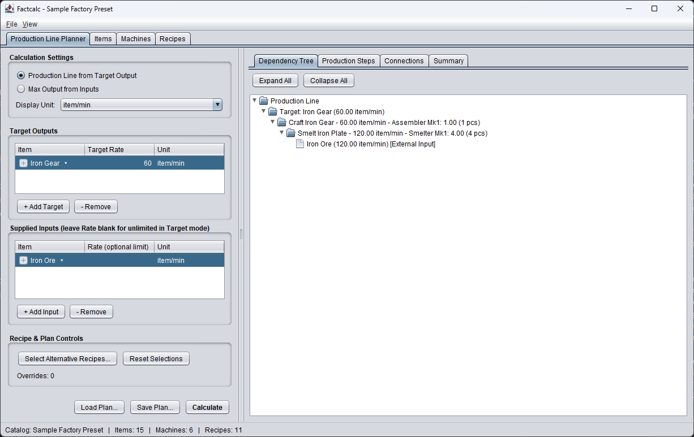
- **Production Steps**: Table of every active recipe step with `Recipe`, `Type`, `Machine`, `Eff. Time (s)`, `Machines Needed` (exact + rounded-up `pcs`), `Inputs`, `Outputs`, `Byproducts`, and `Recursive Reuse`.
  - **Change Machine inline**: Click the **Machine** cell to choose any compatible machine for that recipe; machine counts recalculate immediately.
  - **Recursive Reuse checkbox**: Enabled when a step's byproduct is also consumed as an input in the production line. Toggle it to recycle the byproduct back into the line instead of emitting it as a byproduct output. Self-sustaining loops show an info notice; positive feedback with no external input raises an error; surplus with external inputs is emitted as byproduct output.
  - **Change Recipe...**: Select a step and click this button to switch the step's output to another original or alternative recipe and recalculate immediately.
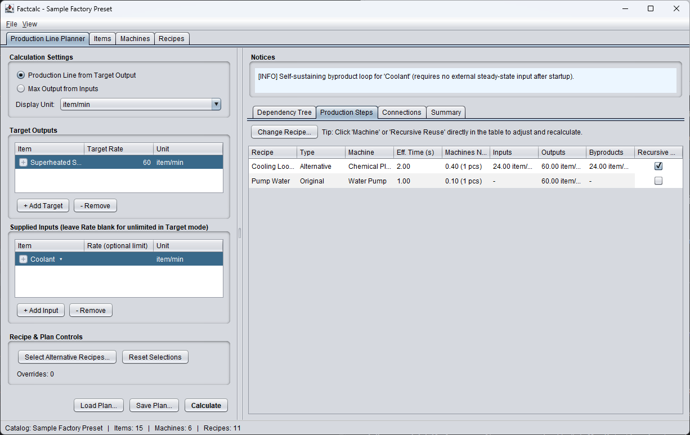
- **Connections**: Explicit directed flow list (`Source`, `Item`, `Rate`, `Target`, `Connection Type`) showing how external inputs, intermediate steps, recycled feedback loops, final outputs, and byproduct outputs connect.
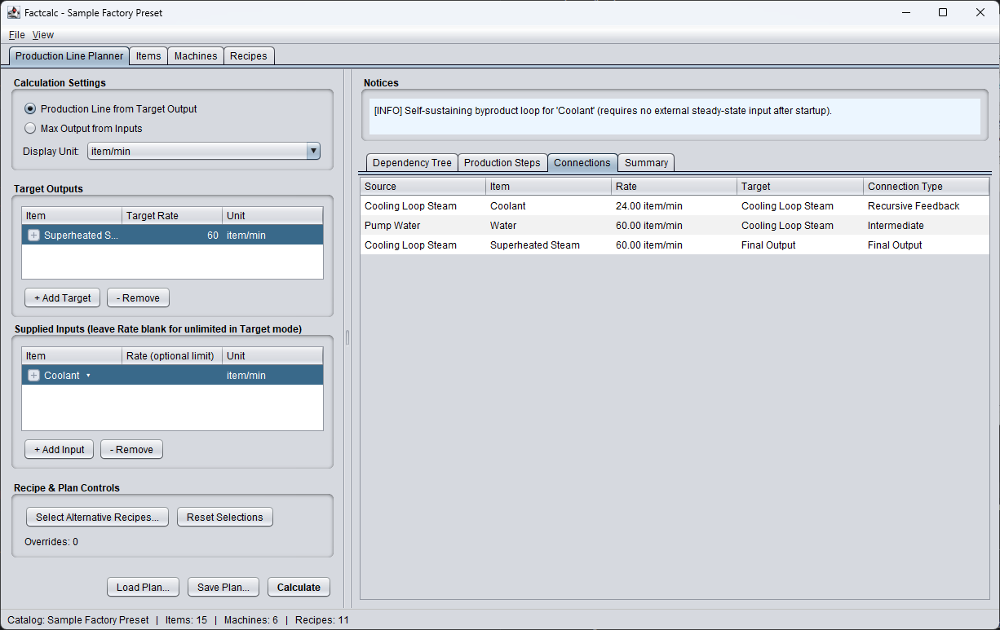
- **Summary**: Four overview tables **User-Supplied Inputs** (with `Bottleneck`, `Deficit`, or `OK` status), **Calculated Missing Inputs**, **Final Outputs & Byproducts**, and **Aggregated Machine Requirements** (exact and rounded totals per machine).
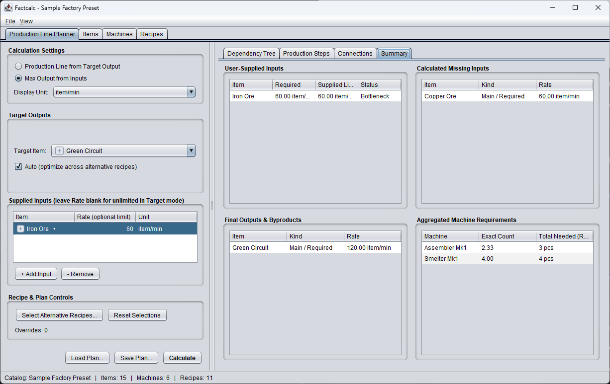

---

## 4. Catalog Management Tabs

All three catalog tabs share a live **Filter** box, sortable table columns, double-click to edit, and **Add** / **Edit** / **Delete** buttons.

### 4.1 Items Tab

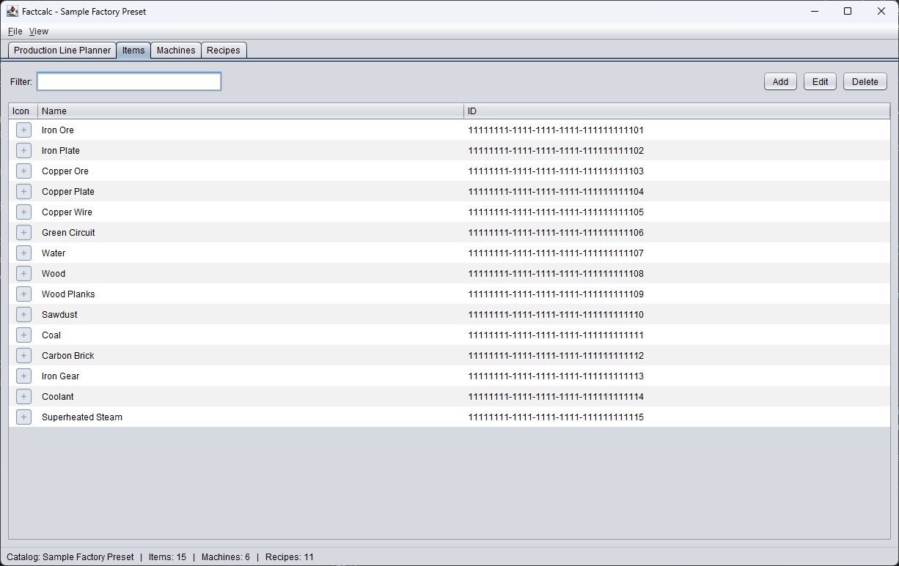

- Displays plain items (`Icon`, `Name`, `ID`).
- **Add / Edit**: Set **Name** (required) and optional **Icon URL / Path** (type a URL/path or click **Browse...**) with a live icon **Preview**.
- **Delete**: Blocked if any recipe references the item in its inputs, outputs, or byproducts; the dialog lists the blocking recipes.

### 4.2 Machines Tab

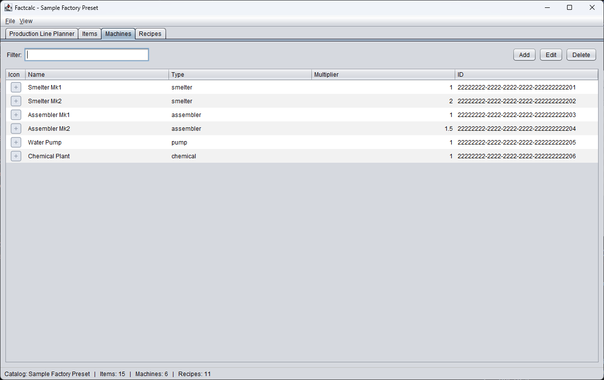

- Displays machines (`Icon`, `Name`, `Type`, `Multiplier`, `ID`).
- **Add / Edit**: Set **Name**, **Type** (pick an existing category such as `assembler` or `smelter`, or type a new one), **Multiplier** (`> 0`, base speed multiplier), and optional **Icon URL / Path**.
- Machines are specialized items, so they can also be crafted as recipe inputs or outputs (e.g., *Craft Assembler Mk1*).
- **Delete / Type Change**: Blocked if any recipe references the machine as an ingredient/output, references it by specific machine ID, or would be left with no compatible machine.

### 4.3 Recipes Tab

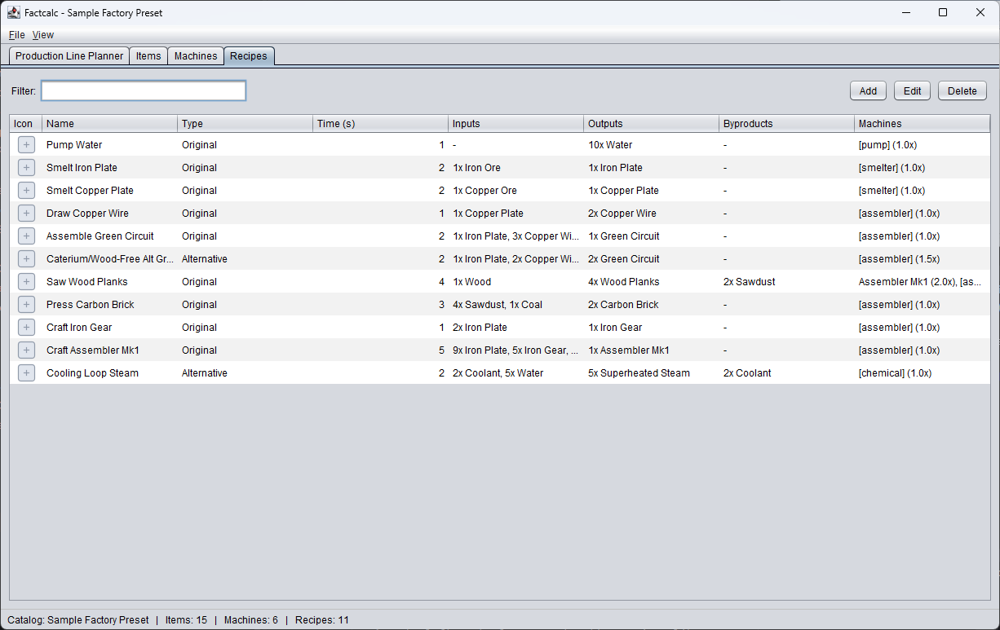

- Displays recipes (`Icon`, `Name`, `Type`, `Time (s)`, `Inputs`, `Outputs`, `Byproducts`, `Machines`).
- **Add / Edit**:
  - **Name**, **Production Time (sec)** (`> 0`), **Original Recipe** checkbox (uncheck to mark as an alternative recipe), and **Icon URL / Path** (leave blank to inherit the primary output's icon).
  - **Usable Machines**: Add rows in either `Machine Type` mode or `Specific Machine` mode with a **Recipe Multiplier** (`> 0`). A specific machine entry overrides a generic type entry. Effective crafting time is:
    $$\text{Effective Time} = \frac{\text{Recipe Time}}{\text{Recipe Multiplier} \times \text{Machine Multiplier}}$$
  - **Inputs**: Required items and quantities per cycle (may be left empty for raw extraction recipes like *Pump Water*).
  - **Outputs**: At least one main output item and quantity per cycle.
  - **Byproducts**: Optional secondary outputs per cycle (eligible for recursive reuse if also consumed in a production line).
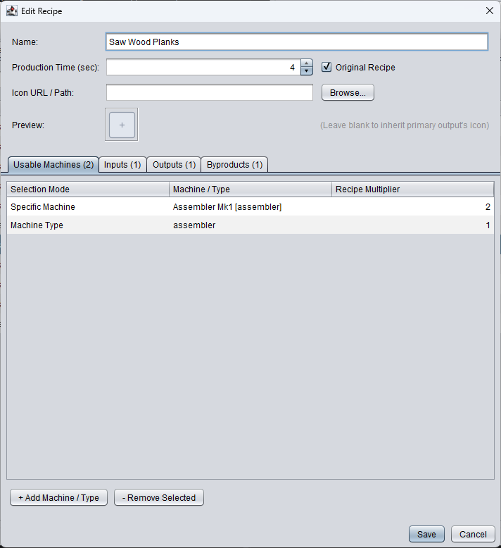
- **Delete**: Immediately removes the recipe and refreshes the planner.

